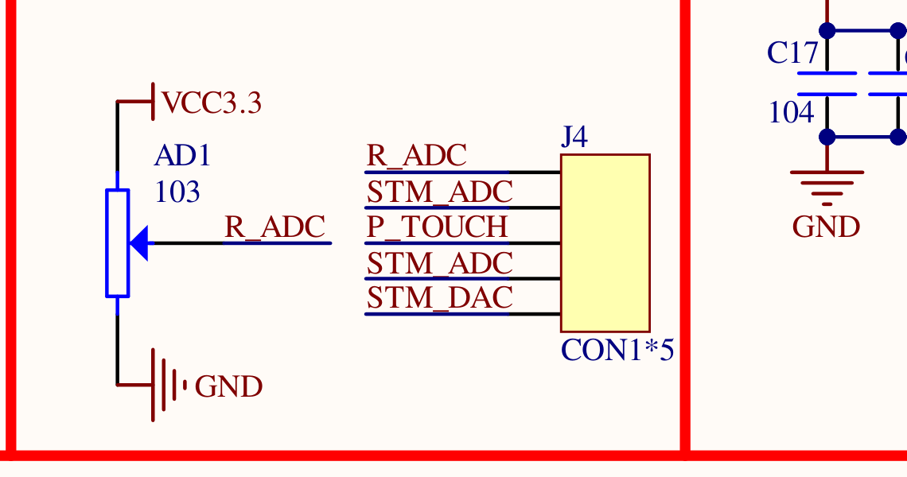
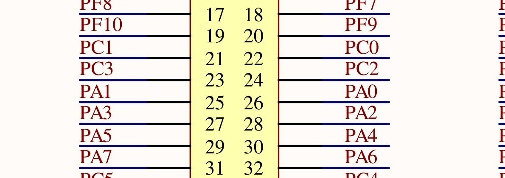

# 双通道示波器：第二路 ADC 选哪个引脚（按冠军407 原理图）

> **当前代码（按实际接线）**：CH1 = **PA4/ADC1_IN4**，CH2 = **PA5/ADC2_IN5**；
> ADC1+ADC2 双规则同时模式，TIM3 TRGO 共同触发，DMA 从 `ADC->CDR` 打包。
> Keil ARMCC V5.06 编译 **0 Error / 0 Warning**。
>
> **注意**：PA4 同时是 **DCMI_HSYNC**，PA6 是 **DCMI_PIXCLK**。板上插着摄像头模块时，这两个脚会被摄像头驱动，ADC 读到的不是外部信号；用 PA4 做 CH1 前必须拔掉摄像头模块。
>
> 如果摄像头不能拔，第二选择是把 CH1 信号改到 **PA0（P8 第 26 脚）**，代码改成 CH1=PA0/ADC1_IN0、CH2=PA5/ADC2_IN5。
>
> 当前接线：CH1 = **PA4**（J4 第 5 脚，STM_DAC/DCMI_HSYNC），CH2 = **PA5**（J4 第 2/4 脚，STM_ADC）。
> PA4 不是专用 ADC 输入，拔掉摄像头模块后才能作为 CH1 模拟输入；若不能拔摄像头，把 CH1 改到 PA0。

---

## 1. J4 只有一路 ADC，不是两路

原理图 J4 是 5 脚排针（`CON1*5`）：

| J4 脚 | 网络 | 说明 |
|---|---|---|
| 1 | R_ADC | 板上 10k 电位器 AD1(103) 的中间抽头，是“信号源”，不是 MCU 输入 |
| 2 | STM_ADC | **PA5 / ADC1_IN5**，第一路输入 |
| 3 | P_TOUCH | 触摸信号 |
| 4 | STM_ADC | 和 2 脚是**同一个 STM_ADC 网络**，仍然只有 PA5 |
| 5 | STM_DAC | **PA4 / DAC_OUT1**，DAC 输出，不是独立 ADC 输入 |

所以 J4 看起来有两个 `STM_ADC`，但 2、4 脚在原理图上是同一个网络，都到 PA5；J4 本身给不出第二路 ADC。

电位器 AD1 的一端接 3.3 V、一端接 GND，中间抽头就是 J4 的 1 脚 R_ADC。它只是板上的测试信号源；要用它测 ADC，需要把 J4 的 1 脚和 2/4 脚短接（或飞线到 PA5）。

---

## 2. 第二路从 P8 排针取 PA6

原理图 P8 是 2×? 扩展排针，PA5 附近这几脚是：

| P8 脚 | 网络 | ADC 能力 | 能不能做第二路 |
|---|---|---|---|
| 29 | PA5 | ADC1_IN5 / ADC2_IN5 | 第一路已用 |
| 30 | PA4 | ADC1_IN4 / ADC2_IN4 | **不建议**：STM_DAC，板上 DAC/RC |
| 31 | PA7 | ADC1_IN7 / ADC2_IN7 | 不建议：ETH_RMII_CRS_DV，LAN8720 输出 |
| **32** | **PA6** | **ADC1_IN6 / ADC2_IN6** | **推荐**：没有摄像头时就是自由 IO |
| 33 | PC5 | ADC1_IN15 / ADC2_IN15 | 不建议：ETH_RMII_RXD1 |
| 34 | PC4 | ADC1_IN14 / ADC2_IN14 | 不建议：ETH_RMII_RXD0 |
| 35 | PB1 | ADC1_IN9 / ADC2_IN9 | 不建议：电阻触摸 T_PEN |
| 36 | PB0 | ADC1_IN8 / ADC2_IN8 | 不建议：电阻触摸 T_SCK |
| 37 | PF11 | 非 ADC（触摸 T_MOSI） | 不建议：触摸 T_MOSI |

PA6 在 MCU 引脚名里是：

`PA6 / ... / DCMI_PIXCLK / ADC12_IN6`

- **ADC12_IN6** 表示 ADC1 和 ADC2 都能采它；
- 它同时是摄像头 DCMI 的 PIXCLK；不接摄像头模块时，P8 第 32 脚就是可用的模拟输入；
- 如果板上插了摄像头，PA6 会被摄像头时钟驱动，不能当 ADC 用。

所以：**CH1 = PA5/ADC1_IN5（J4），CH2 = PA6/ADC2_IN6（P8 第 32 脚，GND 共地）**。

---

## 3. 为什么必须用 ADC1+ADC2 双同时模式

如果两路都接在 ADC1 上做扫描（IN5、IN6），ADC 是 **分时** 转换：先采 CH1，再采 CH2。这只能叫“双通道轮流采样”，不满足“两路同一时刻采样、不得分时”的验收要求。

正确做法：

- ADC1 采 **IN5（PA5）**；
- ADC2 采 **IN6（PA6）**；
- 两者配置成 **Dual Regular Simultaneous**（双规则同时）模式；
- 同一个 TIM3 TRGO 同时触发 ADC1 和 ADC2；
- DMA 一次搬两个结果（ADC1/ADC2 各一个），或两个 DMA 流分别搬。

这样两路是同一时刻的采样保持，相位差测量才有意义。

> 注意：PA6 同时也是 TIM3_CH1；这里 TIM3 只用 TRGO(Update) 做触发，不用 CH1 输出，所以不冲突。

---

## 4. 不建议的“第二路”候选

| 引脚 | 原因 |
|---|---|
| PA4 | STM_DAC / DAC_OUT1，板上有 DAC/RC；你已实测 Vpp/VDC 不准 |
| PA7 | LAN8720 的 RMII_CRS_DV 输出，PHY 会驱动 |
| PC4/PC5 | LAN8720 的 RMII_RXD0/RXD1，PHY 会驱动 |
| PB0/PB1 | 电阻触摸 T_SCK/T_PEN，触摸扫描在用 |
| PF11 | 触摸 T_MOSI |
| PA0 | WK_UP 按键 |
| PA1 | RMII_REF_CLK（25 MHz PHY 时钟） |
| PA2/PA3 | USART2 TX/RX（命令串口） |
| PF3~PF10 | FSMC LCD / ADC3，已被屏幕占用 |

如果不用以太网、也不用摄像头，PA7 理论上也能当 ADC，但 PA7 是 PHY 输出，风险比 PA6 大；优先 PA6。

---

## 5. 接线与代码要点

1. CH1：信号源 → J4 的 2 或 4 脚（PA5），GND 共地；
2. CH2：信号源 → P8 第 32 脚（PA6），GND 共地；
3. 两路输入都必须在 0~3.3 V，不能为负、不能超 3.3 V；
4. `adc.c` 里 CH1 配 `GPIO_Pin_4` + `ADC_Channel_4`；
5. CH2 配 `GPIO_Pin_5` + `ADC_Channel_5`（ADC2）；
6. `ADC_CommonInitStructure.ADC_Mode = ADC_DualMode_RegSimult`（双规则同时）；
7. 触发源仍用 TIM3 TRGO，两个 ADC 同时收到触发；
8. DMA 用双通道模式（CDR）或两个流，保证每个触发点拿到一对 CH1/CH2。
