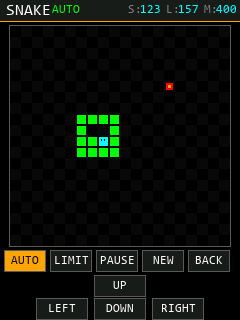

# 最后一页：贪吃蛇

> 工程：`简易示波器及信号发生器`  
> 入口：从 `MAZE` 页第一排点 **`SNAKE`**（`MAZE` 才是开机长按 START 3 秒的迷宫彩蛋）  
> 页面顺序：`PWM → CAPTURE → TIMER → SWEEP → SPWM → MAZE → SNAKE`，贪吃蛇仍是最后一页  
> 代码：`APP/app_snake.c`、`APP/app_snake.h`、`APP/ui_pages.c`（Snake 页）、`APP/ui_core.c`（全屏导航开关）

---

## 1. 怎么玩

### 1.1 进入

1. 上电，短击 `START`，进入 `PWM` 主界面；
2. 按底部 `NEXT` 依次经过 `CAPTURE → TIMER → SWEEP → SPWM → MAZE`；
3. 在 `MAZE` 页第一排点 `SNAKE`，进入全屏贪吃蛇，蛇从中间自动开始移动。

> 未完成触摸校准时会先要求校准；校准参数存在 24C02，换屏/改屏幕方向后要重新校准。

### 1.2 操作

| 操作 | 方式 |
|---|---|
| 转向 | 在棋盘上 **滑动**（上/下/左/右），或点底部方向键 |
| 实体按键 | `WK_UP`=上，`KEY0`=左，`KEY1`=下，`KEY2`=右（冠军 407 板：PA0 / PE4 / PE3 / PE2） |
| 暂停/继续 | `PAUSE` / `RUN` |
| 重开 | `NEW` |
| 自动模式 | `AUTO`（从新一局开始） |
| 自动得分上限 | `LIMIT`：打开数字键盘输入 1..400 |
| 退出 | `BACK`（回 PWM 主界面；再按 BACK 回开始界面） |

规则：

- 20×20 棋盘，初始长度 3，每吃一个食物 `长度+1`、`分数+1`；
- 撞墙或撞到自己 → `GAME OVER`，按 `NEW` 重来；
- 长度达到 400（吃满全屏）→ `YOU WIN!`；
- `LIMIT` 是自动模式的得分上限：默认 400（吃满全屏）。AUTO 达到上限后显示
  `SCORE LIMIT REACHED`（上限 400 时显示 `BOARD 400/400 FILLED`）；
- 手动模式不受 `LIMIT` 影响；`LIMIT` 会一直保留到下次修改或重启；
- 离开页面自动暂停，回来后按 `RUN` 继续；
- 自动模式下方向输入被忽略；`AUTO` 再按一次可退回手动（保留当前局面）。

### 1.3 画面

```
y=0..21     SNAKE | 状态(RUN/PAUSED/OVER/WIN/AUTO) | S:分数 L:长度 M:上限
y=26..245   20x20 棋盘（每格 11px，共 220x220）
y=250..271   AUTO   LIMIT   PAUSE   NEW   BACK
y=275..296                UP
y=298..319        LEFT    DOWN    RIGHT
```

进入本页会隐藏底部统一的 `BACK/NEXT` 导航条（`UI_NavSetVisible(0)`），
退出时由 `UI_SetPage()` 自动恢复，其他页面不受影响。

> 下图是按实际布局常量生成的示意图（不是实机截图，颜色/字体以屏幕为准）：
>
> 

> 按钮只有 22px 高，触摸屏边缘可能不太准；转向优先用棋盘滑动，方向键作为备用。

---

## 2. 自动模式怎么保证吃满

### 2.1 哈密顿回路

20×20 网格上预生成一条 **哈密顿回路**：从起点出发，不重复地走遍 400 个格子，最后回到起点。
蛇身初始位置按回路对齐。只要沿回路走，蛇永远不会撞到自己，也一定会经过每一个格子。

回路构造（`Snake_BuildCycle()`）：

```
第 0 列从上往下走到底
第 1 列从下往上走到第 1 行（不碰第 0 行）
第 2 列从第 1 行往下走到底
第 3 列再往上……
最后一列从下一直走到第 0 行
再沿第 0 行从右往左回到起点，闭合成环
```

### 2.2 安全捷径

只沿回路走虽然不会死，但吃食物太慢。每一步自动模式会：

1. 看蛇头四个邻居，选一个"沿回路离食物最近"的格子；
2. **虚拟**走这一步，然后沿回路再模拟 `len+1` 步；
3. 模拟时预留最多 `SNAKE_AUTO_FOOD_FOUND`（默认 5）次"吃到食物、尾巴不缩"；
4. 如果模拟中不会撞到自己，就走捷径；否则老老实实沿回路走一格。

这就是经典的 **Hamiltonian cycle + safe shortcuts**：
捷径只加速，不破坏安全性；即使捷径判断失败，沿回路的兜底也保证不会死。
最终 400 格被全部占满，进入 `SNAKE_WIN`（分数 397）。

### 2.3 速度与 LIMIT（重点）

| 参数 | 当前值 | 作用 |
|---|---|---|
| `SNAKE_STEP_MS` | 220 | 手动模式每走一格的时间（ms） |
| `SNAKE_AUTO_STEP_MS` | 40 | 自动模式每 40ms 走一个时间片 |
| `SNAKE_AUTO_STEPS_PER_MS` | 1 | 每个时间片走 1 步 → 约 **25 步/秒** |
| `SNAKE_AUTO_BURST` | 1 | 每次 `SNAKE_Tick` 最多补 1 个时间片 |
| `SNAKE_AUTO_FOOD_FOUND` | 5 | 安全捷径检查里预留的"吃到食物"次数 |
| 默认 `LIMIT` | 400 | 自动模式得分上限（吃满全屏） |

完整一局 400 格大约需要 **2.2 万步**；按当前 40ms/步，约 **15 分钟**。
现场演示有两个办法：

1. **把 `LIMIT` 调小**：例如 `LIMIT=30` 约 68 秒，`LIMIT=20` 约 46 秒，
   `LIMIT=10` 约 23 秒（按约 57 步/食物估算）。达到上限会显示 `SCORE LIMIT REACHED`。
   这是"自动演示一段"，不是吃满全屏。
2. **把 `SNAKE_AUTO_STEP_MS` 调小**：例如改成 5（约 200 步/秒），400 格约 113 秒；
   改成 1（约 1000 步/秒），400 格约 23 秒。改完重新 Build。

> `LIMIT=400` + 默认速度才是"自己把屏幕吃满通关"；只想快速看效果时用
> `LIMIT=20~50`，或者临时减小 `SNAKE_AUTO_STEP_MS`。

### 2.4 验证结果

- 本机用 TinyCC 把当前 `app_snake.c` 抽出来做了不开板的逻辑测试：
  - 手动开始/转向/暂停/撞墙/重开：通过；
  - 自动模式（`LIMIT=400`）10 个随机种子：**10/10 全部 400/400 通关**，
    平均约 2.27 万步；
- Keil ARMCC V5.06 全工程编译：**0 Error；6 Warning 全部来自例程自带的 `tftlcd.c`**；
- 逻辑保证：沿哈密顿回路兜底 + 捷径安全模拟，不会出现"自动模式把自己困死"。

> 以上是逻辑/编译验证；屏幕颜色、触摸手感、实体按键还需要在板上实际跑一遍。
> 40ms/步是按"能看清"调的速度，不是算法极限。

---

## 3. 实现要点

### 3.1 文件分工

| 文件 | 改动 |
|---|---|
| `APP/app_snake.c` | 游戏状态机、食物、碰撞、计分、哈密顿回路、自动安全捷径、得分上限、实体按键轮询 |
| `APP/app_snake.h` | 状态/方向枚举、`SNAKE_Game`、对外 API、增量脏格子接口、`SNAKE_Get/SetScoreLimit` |
| `APP/ui_pages.c` | 全屏 SNAKE 页：状态栏、棋盘、HUD（S/L/M）、5 个功能键、方向键、暂停/结束覆盖层、滑动识别、LIMIT 键盘 |
| `APP/ui_core.c/.h` | 新增 `UI_GoRoot()`（清历史回主界面）和 `UI_NavSetVisible()`（全屏时隐藏导航条） |
| `APP/app_config.h` | `SNAKE_*` 参数（格子大小、手动/自动速度、自动参数、按键开关） |

### 3.2 为什么只重画几个格子

LCD 没有帧缓存，`LCD_Fill` 每次都要设窗口；如果每走一步整屏重画，25Hz 下会明显闪。

- 换页/开局/暂停/结束：整页重画一次（`g_ui_full_redraw=1` + `Page_Begin`）；
- 正常走一步：`app_snake.c` 把"旧尾巴、旧蛇头、新蛇头、食物"等 2~4 个格子放进脏队列；
- 页面 `Snake_Tick()` 取走队列，只重画这些格子；
- 分数/长度/上限变化：只重画顶部 HUD 的固定区域。

### 3.3 LIMIT 键盘

- 点 `LIMIT`：如果贪吃蛇正在跑，先 `SNAKE_TogglePause()` 暂停；
- 用全局 3×4 数字键盘输入 1..400，`OK` 确认；
- 确认后 `SNAKE_SetScoreLimit()` 立即生效；如果当前分数已经 ≥ 新上限，自动模式直接判 `WIN`；
- 键盘关闭后，如果打开前是在跑，`Snake_Tick()` 自动 `RESUME`。

### 3.4 全屏与导航

- `Snake_Enter()` 调 `UI_NavSetVisible(0)`，隐藏底部 `BACK/NEXT`，并把触摸事件从导航栏手里拿回来；
- `Snake_Leave()` 自动暂停，防止离开页面后蛇继续跑；
- 本页 `BACK` 用 `UI_GoRoot(PAGE_PWM)`：清空返回历史，回 PWM 主界面；再按一次 BACK 才回开始界面。

### 3.5 实体按键说明

默认使用冠军 407 的按键：

| 键 | 引脚 | 方向 | 有效电平 |
|---|---|---|---|
| WK_UP | PA0 | 上 | 高 |
| KEY0 | PE4 | 左 | 低 |
| KEY1 | PE3 | 下 | 低 |
| KEY2 | PE2 | 右 | 低 |

- PE2/PE3/PE4 在 `SNAKE_Init()` 里配成上拉输入，和 LCD FSMC（PE7~PE15）不冲突；
- PA0 同时是 TIM5_CH1 输入捕获脚，这里只读 `IDR`，不改 AF 配置，退出贪吃蛇后捕获仍正常；
- 如果你的板子按键不在这几个脚，把 `app_config.h` 的 `SNAKE_KEYS_ENABLE` 改成 0，只用触摸即可。

---

## 4. 参数与调参

都在 `APP/app_config.h` 第 9 节：

```c
#define SNAKE_GRID_W            20
#define SNAKE_GRID_H            20
#define SNAKE_CELL_PX           11      /* 20*11=220，给底部按键留位置 */
#define SNAKE_STEP_MS           220     /* 手动速度 */
#define SNAKE_AUTO_STEP_MS      40      /* 自动模式每个时间片(ms) */
#define SNAKE_AUTO_STEPS_PER_MS 1       /* 每个时间片走几步 */
#define SNAKE_AUTO_BURST        1       /* 每次 SNAKE_Tick 最多补几个时间片 */
#define SNAKE_AUTO_FOOD_FOUND   5
#define SNAKE_AUTO_DEFAULT      0
#define SNAKE_KEYS_ENABLE       1
```

注意：

- `SNAKE_CELL_PX` 改成 12 后棋盘变成 240x240，底部按键要重新排（见 `ui_pages.c` 的 `SK_*` 常量）；
- `SNAKE_GRID_W` 必须是偶数，`Snake_BuildCycle()` 的构造才成立；
- `LIMIT` 是运行时可改的（默认 400），不需要重新编译；
- 自动速度上限受 UI 主循环影响；改 `SNAKE_AUTO_STEP_MS` 后如果画面卡，优先检查触摸扫描和整屏重画。

---

## 5. 板上验收步骤（建议）

1. 烧录 `OBJ/PWM_UI_Framework.hex`（或根目录更新后的 hex），上电进 `WELCOME`；
2. 按住 START 3 秒，确认进入 SNAKE 全屏页，蛇开始移动；
3. 在棋盘上四个方向各滑一次，确认转向正确且不能 180° 回头；
4. 用底部 `UP/LEFT/DOWN/RIGHT` 再试一次（按钮很小，点按要准）；
5. 按 `PAUSE`，确认蛇停住、覆盖层显示 `PAUSED`；按 `RUN` 继续；
6. 故意撞墙，确认 `GAME OVER`，按 `NEW` 重开、分数归零；
7. 按 `LIMIT`，输入 `20`，确认键盘关闭后自动恢复；按 `AUTO`，约 45 秒后
   出现 `YOU WIN!` / `SCORE LIMIT REACHED`；
8. 想验证"吃满全屏"：把 `LIMIT` 设为 400，再按 `AUTO`；默认速度约 15 分钟，
   或先把 `SNAKE_AUTO_STEP_MS` 改成 5 再编译（约 2 分钟）；
9. 按 `BACK` 回 PWM 主界面，再按 BACK 应回开始界面（不会又掉进游戏）；
10. 从 SPWM 页按 NEXT 进 SNAKE，再 BACK，确认导航条恢复、其他页面正常。

---

## 6. 已知限制

- 没有在真实硬件上跑过（本机只能编译 + 不开板的逻辑测试）；触摸校准、屏幕颜色、按键手感需要上板确认；
- 按钮高度只有 22px，电阻屏边缘点按可能需要多试几次；转向优先用滑动；
- 实体按键依赖冠军 407 的引脚定义，换板请关掉 `SNAKE_KEYS_ENABLE`；
- 自动模式默认 40ms/步是为了"看得清"，完整 400 格约 15 分钟；想快速演示请调 `LIMIT` 或 `SNAKE_AUTO_STEP_MS`；
- 界面文字全部 ASCII（例程字库只有 ASCII + 4 个汉字），中文只出现在注释和文档里。
