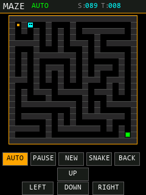

# 彩蛋：走迷宫（A* 自动求解）

> 工程：`简易示波器及信号发生器`  
> 入口：开机 `WELCOME` 界面 **长按 START 3 秒**（`BOOT_LONG_PRESS_MS`）  
> 代码：`APP/app_maze.c`、`APP/app_maze.h`、`APP/ui_pages.c`（Maze 页）、`APP/app_boot.c`（长按入口）  
> 页面顺序：`PWM → CAPTURE → TIMER → SWEEP → SPWM → MAZE → SNAKE`；贪吃蛇仍是最后一页，从 MAZE 页点 `SNAKE` 进入。

---

## 1. 怎么玩

### 1.1 进入

1. 上电，进入 `WELCOME`；
2. 手指按住 `START` 不放，进度条走满 3 秒；
3. 进入全屏 21×21 迷宫，玩家在左上角起点 `(1,1)`，绿色出口在右下角 `(19,19)`。

> 未完成触摸校准时会先要求校准；校准参数存在 24C02，换屏/改屏幕方向后要重新校准。

### 1.2 操作

| 操作 | 方式 |
|---|---|
| 走一格 | 在迷宫区域 **滑动**（上/下/左/右），或点底部方向键 |
| 实体按键 | `WK_UP`=上，`KEY0`=左，`KEY1`=下，`KEY2`=右（冠军 407 板：PA0 / PE4 / PE3 / PE2） |
| 暂停/继续 | `PAUSE` / `RUN` |
| 换新迷宫 | `NEW` |
| 自动求解 | `AUTO`：用 A* 求最短路径后自动回放 |
| 退出 | `BACK`（回 PWM 主界面） |
| 进贪吃蛇 | `SNAKE`（贪吃蛇仍是最后一页） |

规则：

- 只能走到通道格，墙不能穿；走到绿色出口即 `MAZE SOLVED!`；
- 顶部 `S:` 是步数，`T:` 是秒数；暂停时计时停止；
- 手动模式可以随时按 `PAUSE`；自动模式下方向键/滑动被忽略；
- 自动模式再按一次 `AUTO` 可切回手动，保留当前玩家位置；
- 离开页面自动暂停，回来按 `RUN` 继续；
- `NEW` 会重新生成迷宫并回到起点；通关后按 `NEW` 或 `AUTO` 开新一局。

### 1.3 画面

```
y=0..21     MAZE | 状态(RUN/AUTO/PAUSED/WIN) | S:步数 T:秒数
y=26..235   21x21 迷宫（每格 10px，共 210x210）
y=250..271   AUTO   PAUSE   NEW   SNAKE   BACK
y=275..296                UP
y=298..319        LEFT    DOWN    RIGHT
```

进入本页会隐藏底部统一的 `BACK/NEXT` 导航条（`UI_NavSetVisible(0)`），
退出时由 `UI_SetPage()` 自动恢复，其他页面不受影响。

> 下图是按实际布局常量生成的示意图（不是实机截图，颜色/字体以屏幕为准）：
>
> 

---

## 2. 迷宫怎么生成

### 2.1 21×21 奇偶格

- 棋盘 21×21，**奇数坐标是通道，偶数坐标是墙**；
- 起点 `(1,1)`，出口 `(W-2,H-2)=(19,19)`；
- 这样刚好能画出四面都有墙、内部连通的经典迷宫。

### 2.2 迭代 DFS（递归回溯）

`Mz_Generate()` 的做法：

1. 先把所有格子填成墙；
2. 从 `(1,1)` 出发，把当前格标记为通道；
3. 每次找"隔一格"的未访问通道（上/下/左/右，距离 2），随机挑一个；
4. 打通当前格和目标格中间的那面墙，压栈继续；
5. 四个方向都走不通就弹栈，回到上一个分叉；
6. 直到栈空，所有奇数格都被访问，迷宫连通且无环（完美迷宫）。

> 这里用 **显式数组栈**，不是函数递归：工程只有 1KB 栈，DFS 递归深度可能到 100+，
> 显式栈放在静态区更稳。

### 2.3 随机种子

每局用 `TICK_Now()` + 局号做种子，`NEW` 每次都会得到不同迷宫；
同一局内不会重新生成，暂停/继续保持原迷宫。

---

## 3. A* 自动模式

### 3.1 为什么用 A*

迷宫 441 格、分支多，BFS 也能求最短路，但 A* 用"离出口的曼哈顿距离"做启发，
扩展的节点更少；在网格上曼哈顿距离是可采纳（admissible）的，因此 A* 找到的就是最短路径。

### 3.2 实现

`Mz_AStar()`：

- `g[cell]`：起点到该格的实际步数；
- `h(cell)`：该格到出口的曼哈顿距离 `|dx| + |dy|`；
- open 表：`s_open[]`，每次线性扫描 `g+h` 最小的节点（441 格，不用堆也很快）；
- closed 表：`s_closed[]`，避免重复扩展；
- 找到出口后沿 `s_parent[]` 反向回填方向到 `s_path[]`；
- 返回路径长度；0 表示已经在出口或无路。

自动回放：

- `MAZE_StartAuto()` 从 **当前玩家位置** 求路径，不要求从起点开始；
- 每 `MAZE_AUTO_STEP_MS`（默认 90ms）走一格，最多一次补 4 步；
- 走到出口 → `MAZE_WIN`，显示 `MAZE SOLVED!` / `A* PATH COMPLETE`；
- 再按 `AUTO` 可切回手动；按 `PAUSE` 暂停回放。

### 3.3 验证结果

- 主机测试（TinyCC，不开板）：30 个随机种子，**30/30 全部到达出口**；
- 每个迷宫用普通 BFS 算最短路，和 A* 路径长度逐一比较：**全部相等**；
- 平均最短路径约 **89 步**；按 90ms/格，自动约 **8 秒**（5~15 秒）；
- Keil ARMCC V5.06 全工程编译：**0 Error / 6 Warning**（6 条都来自例程 `tftlcd.c`）。

> 以上是逻辑/编译验证；触摸滑动、按键手感和屏幕颜色需要上板确认。

---

## 4. 参数

都在 `APP/app_config.h` 第 9b 节：

```c
#define MAZE_GRID_W          21      /* 必须是奇数 */
#define MAZE_GRID_H          21
#define MAZE_CELL_PX         10      /* 21*10=210, 两侧各留 15px */
#define MAZE_AUTO_STEP_MS    90      /* A* 回放: 每 90ms 走一格 */
#define MAZE_AUTO_DEFAULT    0
#define MAZE_KEYS_ENABLE     1
```

注意：

- `MAZE_GRID_W/H` 改大要同时改 `ui_pages.c` 的 `MZ_*` 布局常量；
- `MAZE_CELL_PX` 改大后棋盘会超出 240 宽，需要重新排版；
- 想让自动更快，把 `MAZE_AUTO_STEP_MS` 改小（如 50），但太小会看不清回放；
- 实体按键不在冠军 407 引脚时，把 `MAZE_KEYS_ENABLE` 改 0，只用触摸。

---

## 5. 板上验收步骤

1. 烧录 `OBJ/PWM_UI_Framework.hex`，上电进 `WELCOME`；
2. 按住 START 3 秒，确认进入 `MAZE` 全屏页，起点在左上角；
3. 在迷宫上四个方向各滑一次，确认只走一格且不能穿墙；
4. 用底部 `UP/LEFT/DOWN/RIGHT` 再试一次；
5. 按 `PAUSE`，确认状态变成 `PAUSED`、计时停止；按 `RUN` 继续；
6. 按 `NEW`，确认生成新迷宫并回到起点；
7. 按 `AUTO`，确认自动求解并在出口显示 `MAZE SOLVED!` / `A* PATH COMPLETE`；
8. 按 `AUTO` 再切回手动，确认可以继续走；
9. 按 `SNAKE`，确认进入最后一页贪吃蛇；按 `BACK` 回 PWM；
10. 从 SPWM 页按 NEXT 进 MAZE，再按 BACK，确认导航条恢复、其他页正常。

---

## 6. 已知限制

- 没有在真实硬件上跑过（本机只能编译 + 不开板逻辑测试）；触摸校准、按键手感、屏幕颜色需上板确认；
- 迷宫格 10px，滑动/点方向键比蛇页更考验触摸精度；建议优先滑动；
- 自动模式是"回放最短路径"，不会像人一样边走边看；想看清过程可把 `MAZE_AUTO_STEP_MS` 调大；
- 迷宫是完美迷宫（无环），手动只有一条正确路线；如果想更容易，可在生成后随机打通一些墙形成环路；
- 界面文字全部 ASCII（例程字库只有 ASCII + 4 个汉字），中文只出现在注释和文档里。
