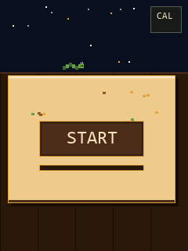

# 第二题工程框架（PWM + 输入捕获 + 触摸屏 UI）

这是从 `第二题例程` 复制并改名的**可编译骨架**，用于 2026 创新实验室招新软件考核第二题。

## 打开

- Keil 工程：`USER/PWM_UI_Framework.uvprojx`
- 编译器：ARMCC V5.06（原工程配置）
- 目标：STM32F407ZGT6，168MHz，ILI9341 240x320 竖屏

## 当前状态

- ✅ 工程可完整编译：0 error；6 条警告全部来自例程自带的 `tftlcd.c`
- ✅ TIM6 1ms 节拍、触摸事件、页面管理、脏区域重绘、文字工具
- ✅ **开机流程**：`TP_InitNoCalib()` → `WELCOME` 开始界面 → 需要时四点校准 → 目标页（短击 PWM，长按 MAZE）
- ✅ **页面管理**：页面表 + 底部 `BACK/NEXT` 导航；`WELCOME` 右上角 `CAL` 十字可重新校准
- ✅ **开始界面**：羊皮纸面板中间是 START 木框；星空/木板交界上方有毛毛虫来回蠕动
- ✅ **PWM 页最小交互**：显示实际/设定频率、占空比，OUT ON/OFF 可切换
- ✅ 主 PWM 上电自检：**PA8 输出 1kHz / 50%**
- ✅ 输入捕获已按 PWM 输入模式初始化（TIM5_CH1 / PA0）
- ✅ **迷宫彩蛋**：长按 START 3 秒进入 21×21 全屏迷宫；滑动/方向键/实体按键走格，`AUTO` 用 **A* 最短路径**自动求解
- ✅ **最后一页贪吃蛇**：页面顺序最后一页，从 MAZE 页点 `SNAKE` 进入；触摸/按键/计分/暂停/重开/LIMIT 保留
- ✅ 根目录 `PWM_UI_Framework.hex` 是当前框架的预编译自检固件（改代码后重新 Build）
- ⬜ 页面美化、数字键盘、滑动条、各页操作按钮
- ⬜ PWM 通用算法、捕获计算、扫频、SPWM（贪吃蛇/迷宫已完成）
- ⬜ 所有可调参数（集中在 `APP/app_config.h`）

## 先看这四份文档

1. [`00-题目要求与坑点审查.md`](00-题目要求与坑点审查.md)
   —— 题目/评分拆解、例程里真实存在的坑（字库只有 4 个汉字、SysTick 被 delay 占用、1KB 栈、触摸校准等）、验收自测表。
2. [`01-代码框架与TODO说明.md`](01-代码框架与TODO说明.md)
   —— 目录结构、启动流程、UI 机制、TODO 清单、调参表、硬件接线、分阶段路线。
3. [`02-贪吃蛇彩蛋说明.md`](02-贪吃蛇彩蛋说明.md)
   —— 最后一页贪吃蛇：操作方式、哈密顿回路 + 安全捷径自动通关原理、调参和板上验收步骤。
4. [`03-迷宫彩蛋说明.md`](03-迷宫彩蛋说明.md)
   —— 长按 START 迷宫彩蛋：21×21 生成、A* 求解/回放、操作方式、参数和验收步骤。

## 硬件默认引脚

| 用途 | 引脚 | 说明 |
|---|---|---|
| 主 PWM | PA8 / TIM1_CH1 | 168MHz，高级定时器，已开 MOE |
| 第二路/相位 | PC6 / TIM8_CH1 | 拓展1，独立 1kHz 自检 |
| 输入捕获 | PA0 / TIM5_CH1 | 32 位；部分板 PA0 是 WK_UP |
| SPWM | PA6 / TIM3_CH1 | 拓展4，默认不启动 |
| 1ms 节拍 | TIM6 | 无引脚 |

> 接线前先对照开发板排针确认；如果 PA0 被 WK_UP 占用，可改 TIM2_CH1/PA5。

## 上电应该看到

- 先显示 **`WELCOME` 开始界面**：
  - 已校准：显示 `START` 按钮（短击进 PWM 主界面）和右上角 `CAL` 十字；
  - 未校准：点一下进入四点校准；
  - 不自动跳页，等用户操作（`BOOT_SPLASH_TIMEOUT_MS=0`）。
- 开始界面：`START` 木框位于羊皮纸面板正中间；星空与木板交界上方有一条毛毛虫来回蠕动。
  > 示意图（非实机截图）：
- **长按 START 3 秒**：进入迷宫彩蛋（详见 [`03-迷宫彩蛋说明.md`](03-迷宫彩蛋说明.md)）。
- 各页面底部有统一的 `BACK/NEXT` 导航（MAZE/SNAKE 全屏页会隐藏）；当前页面顺序：
  `PWM → CAPTURE → TIMER → SWEEP → SPWM → MAZE → SNAKE → PWM`。
  MAZE 页第一排有 `SNAKE` 按钮，点它进入最后一页贪吃蛇。
- PWM 页显示 CH1/CH2 波形和参数，`CH1/CH2` 按钮可开关输出。
- 示波器 PA8：1kHz、50% 方波；若 EEPROM 没有触摸校准参数，开始界面会引导四点校准（阻塞，10 秒超时）。

## 彩蛋：长按 START 进入迷宫

- 在 `WELCOME` 界面按住 `START` **3 秒**进入全屏 21×21 迷宫；
- 起点左上角 `(1,1)`，出口右下角 `(19,19)`；从起点走到绿色出口即通关；
- 触摸：在迷宫里滑动走一格，或点底部 `UP/LEFT/DOWN/RIGHT`；
- 实体按键：`WK_UP/KEY0/KEY1/KEY2` = 上/左/下/右；
- 第一排：`AUTO` 自动模式（**A\* 最短路径**回放）、`PAUSE/RUN`、`NEW` 换新迷宫、`SNAKE` 进最后一页贪吃蛇、`BACK` 回主界面；
- 自动模式速度默认 90ms/格，一局通常在 5~15 秒内解完；
- 详细原理、参数和验收步骤见 [`03-迷宫彩蛋说明.md`](03-迷宫彩蛋说明.md)。

## 最后一页：贪吃蛇

- 从 `MAZE` 页点 `SNAKE` 进入；页面顺序里它仍是最后一页；
- 触摸：棋盘上滑动转向，或点底部 `UP/LEFT/DOWN/RIGHT`；
- 实体按键：`WK_UP/KEY0/KEY1/KEY2` = 上/左/下/右（默认按冠军 407 引脚，可在 `app_config.h` 关闭）；
- 第一排：`AUTO` 自动模式、`LIMIT` 自动得分上限（1..400，默认 400 吃满全屏）、
  `PAUSE/RUN`、`NEW`、`BACK`；
- 自动模式速度默认 40ms/步，完整 400 格约 15 分钟；现场快速演示把 `LIMIT` 调到 20~50，
  或把 `SNAKE_AUTO_STEP_MS` 改小（详见说明文档）；
- 详细原理、参数和验收步骤见 [`02-贪吃蛇彩蛋说明.md`](02-贪吃蛇彩蛋说明.md)。

## 下一步

按 `01-代码框架与TODO说明.md` 的 TODO 顺序填：

1. `TODO-01/02/03`：PWM 全频段
2. `TODO-05`：捕获计算
3. `TODO-12/14/15`：键盘/菜单/PWM 页
4. `TODO-07/17`：秒表
5. 拓展按性价比：滑条 → 相位 → 扫频 → SPWM → **迷宫/贪吃蛇（已完成）** → 500k

> 框架故意不包含算法和界面布局，避免限制你的实现思路；每个留白处都有 `TODO-xx` 注释说明作用和验收标准。
